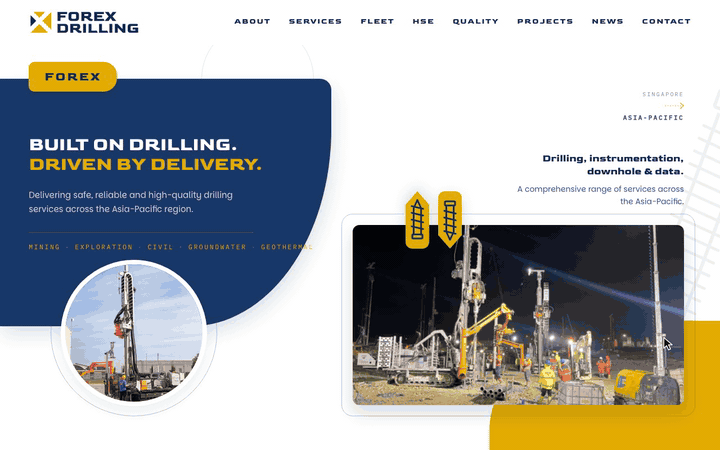
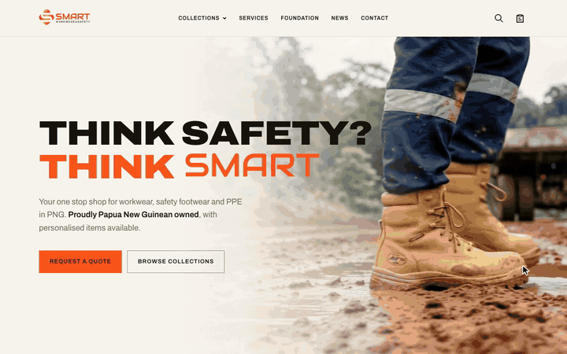

<a href="https://github.com/SHN5906">Français</a> · <b>English</b>

I run [Zyrk](https://zyrk.fr/en), my agency on the French Riviera: websites, business tools for companies, video production and editing.

**Live**

- [Forex Drilling](https://forexdrilling.com): website for a drilling contractor, Singapore and Papua New Guinea

  

- [Smart Workwear Safety](https://www.smarttwear.com): website for a workwear and PPE supplier in Papua New Guinea, with collections shown on a 3D model

  

**Side projects**

- [claude-maskot](https://github.com/SHN5906/claude-maskot): your Claude Code session status, as a macOS widget
- Organizr: mission planning and client portal
- Gamefolio: trading card game with play money

**Stack:** TypeScript, Next.js, React, Tailwind, Supabase, Python, Frappe/ERPNext

**Contact:** [zyrk.fr/en/contact](https://zyrk.fr/en/contact)
