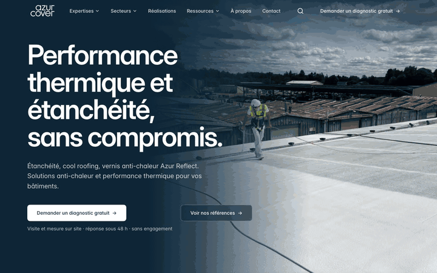
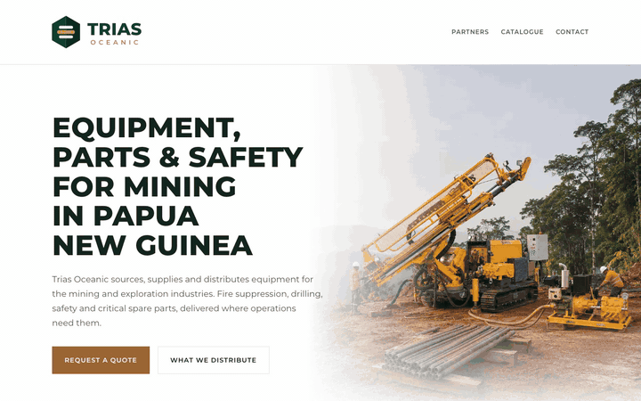

### Sohan

Étudiant à Epitech (promo 2028). Je dirige Zyrk, mon agence sur la Côte d'Azur : sites internet, systèmes sur mesure pour les professionnels, réalisation et montage vidéo.

**En production**

- [Azur Cover](https://azurcover.com) : site d'un spécialiste de l'étanchéité et du cool roofing

  

- [Forex Drilling](https://forexdrilling.com) : site d'un contracteur de forage, Singapour et Papouasie-Nouvelle-Guinée

  

- [Trias Oceanic](https://trias-oceanic.vercel.app) : site d'un distributeur d'équipements miniers, Papouasie-Nouvelle-Guinée

  

**À côté**

- [claude-maskot](https://github.com/SHN5906/claude-maskot) : l'état de ta session Claude Code, en widget macOS
- [Organizr](https://github.com/SHN5906/Organizr) : planification de missions et espace client
- [GameFolio](https://github.com/SHN5906/Gamefolio) : jeu de cartes à collectionner en monnaie fictive

**Stack :** TypeScript, Next.js, React, Tailwind, Supabase, Python, Frappe/ERPNext
