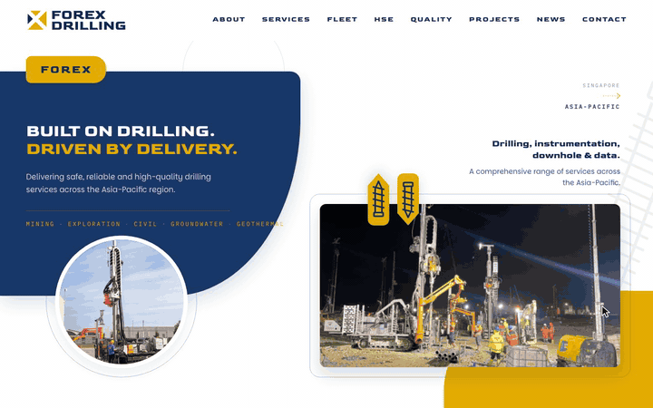
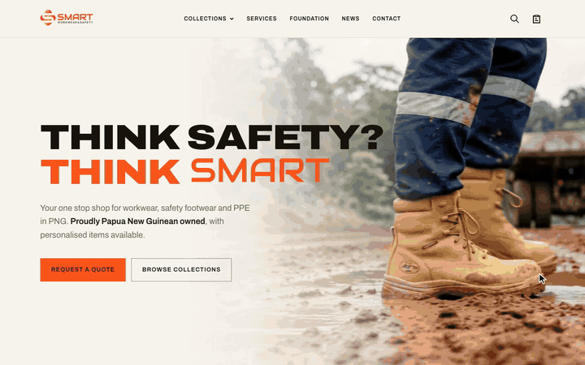

English

I run [Zyrk](https://zyrk.fr/en), my agency on the French Riviera: websites, business tools for companies, video production and editing.

**Live**

- [Forex Drilling](https://forexdrilling.com): website for a drilling contractor, Singapore and Papua New Guinea

  

- [Smart Workwear Safety](https://www.smarttwear.com): website for a workwear and PPE supplier in Papua New Guinea, with collections shown on a 3D model

  

- Forex Drilling ERP (Frappe): site safety, maintenance and rig telemetry

**Side projects**

- [claude-maskot](https://github.com/SHN5906/claude-maskot): your Claude Code session status, as a macOS widget
- Organizr: mission planning and client portal
- Gamefolio: trading card game with play money

**Stack:** TypeScript, Next.js, React, Tailwind, Supabase, Python, Frappe/ERPNext

**Contact:** [zyrk.fr/en/contact](https://zyrk.fr/en/contact)

Français

Je dirige [Zyrk](https://zyrk.fr), mon agence sur la Côte d'Azur : sites internet, outils métier pour les professionnels, réalisation et montage vidéo.

**En production**

- [Forex Drilling](https://forexdrilling.com) : site d'un contracteur de forage, Singapour et Papouasie-Nouvelle-Guinée

  

- [Smart Workwear Safety](https://www.smarttwear.com) : site d'un fournisseur de vêtements de travail et d'EPI en Papouasie-Nouvelle-Guinée, collections présentées sur un modèle 3D

  

- ERP de Forex Drilling (Frappe) : sécurité sur site, maintenance et télémétrie des foreuses

**À côté**

- [claude-maskot](https://github.com/SHN5906/claude-maskot) : l'état de ta session Claude Code, en widget macOS
- Organizr : planification de missions et espace client
- Gamefolio : jeu de cartes à collectionner en monnaie fictive

**Stack :** TypeScript, Next.js, React, Tailwind, Supabase, Python, Frappe/ERPNext

**Contact :** [zyrk.fr/contact](https://zyrk.fr/contact)

